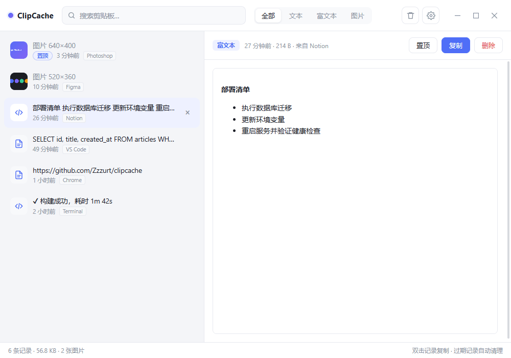

# ClipCache

Windows 剪贴板管理器：自动记录复制的文字、图片与富文本，本地保存，可设定保留时间，到期自动清理。



## 特性

- 记录纯文本、富文本（HTML / RTF）与图片，图片统一转存为 PNG
- 置顶记录永不过期，始终排在最前
- 保留时间可选 24 小时 / 3 天 / 7 天 / 30 天 / 永久，到期自动清理
- 搜索、类型过滤、双击写回剪贴板、浅色 / 深色主题
- 识别剪贴板隐私标记，密码管理器复制的内容不会被记录

## 安装

从 [Releases](https://github.com/Zzzurt/clipcache/releases) 下载 `ClipCache_x.y.z_x64-setup.exe` 运行安装。

要求 Windows 10/11，WebView2 运行时（系统一般已内置）。

## 隐私

应用会跳过标记为机密的剪贴板内容，命中下列任一情况即静默忽略：

- `Clipboard Viewer Ignore`
- `ExcludeClipboardContentFromMonitorProcessing`
- `CanIncludeInClipboardHistory = 0`
- `CanUploadToCloudClipboard = 0`

密码管理器、浏览器无痕窗口与 Windows 凭据管理器都会设置这些标记。

需要注意两点：

- **记录以明文保存**，没有内置加密。请自行控制数据目录的访问权限，或缩短保留时间。
- **富文本预览会加载 https 图片**（脚本已禁止）。打开含远程图片的记录时会向图片所在站点发起请求，对方可能由此得知你的 IP 以及这条内容被查看过。

## 数据位置

默认位于 `%APPDATA%\com.clipcache.app\`，可用环境变量 `CLIPCACHE_DATA_DIR` 覆盖。

```
clips.json          记录与文本内容
settings.json       设置
images/             图片与缩略图
```

## 已知限制

- 最多保留 1000 条记录，超出部分按最旧优先裁剪
- 无托盘图标、无开机自启、无多语言
- 富文本预览不会加载 http（非 https）图片

## 开发

需要 Node.js ≥ 18 与 Rust（`x86_64-pc-windows-msvc`）。

```bash
npm install
npm run tauri dev      # 开发运行
npm run tauri build    # 构建安装包
```

技术栈为 Tauri 2 + 原生 HTML/CSS/JS，后端通过原生 Win32 FFI 访问剪贴板。

```bash
cargo test --manifest-path src-tauri/Cargo.toml
cargo fmt --manifest-path src-tauri/Cargo.toml --all --check
cargo clippy --manifest-path src-tauri/Cargo.toml --all-targets -- -D warnings
```

两个写真实系统剪贴板的测试默认标记为 `#[ignore]`，需要时用 `cargo test -- --ignored` 运行。

## 许可证

[MIT](LICENSE)
